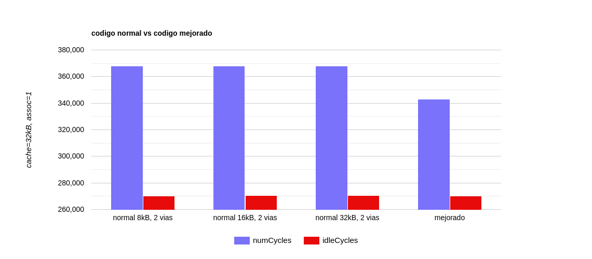
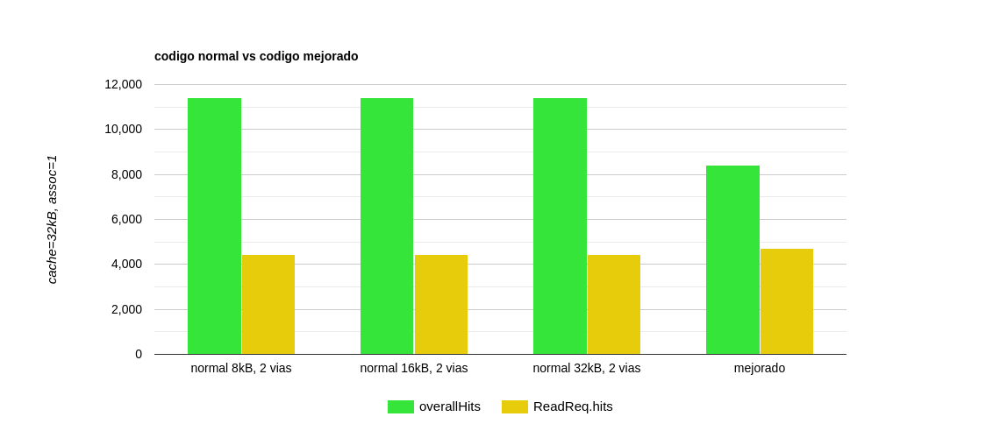
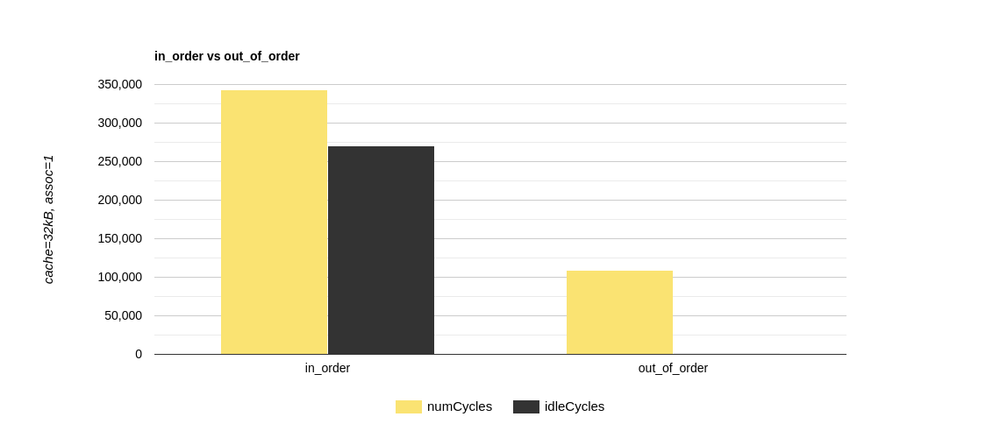
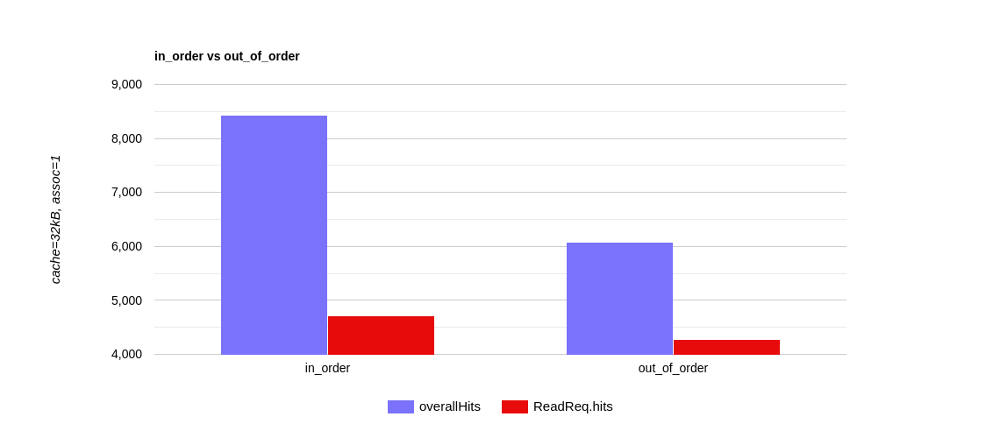

# Arquitectura de Computadoras - 2025
## Informe Lab2:  Análisis de microarquitecturas

## Integrantes:
- **Integrante 1: Lautaro Pinilla**
- **Integrante 2: Milena Juarez**

## Ejercicios resueltos:
- Ejercicio 1

# Incisos a-b-c-d
## Codigo utilizado
Usamos fmul y fadd porque usamos punto flotante.  
Agregamos este codigo al `benchmarks/ej_daxpy.s`:  
```asm
//=== INICIALIZACION ===
//Cargar parametros y configurar vectores
ldr w0, N              			//w0 = N = 4096 elementos
fmov d0, #2.5          			//d0 = alpha = 2.5
    
//Obtener direcciones base de los vectores
adr x1, X              			//x1 => base de X
adr x2, Y              			//x2 => base de Y
adr x3, Z              			//x3 => base de Z
    
//Inicializar vectores X e Y
fmov d1, #1.0          			//d1 = 1.0 (valor para X,  X[i] = 1.0)
fmov d2, #2.0          			//d2 = 2.0 (valor para Y,  Y[i] = 2.0)
mov x5, #0             			//x5 = i = 0 (contador)

//=== LOOP DE INICIALIZACION ===
init_loop:
    cmp x5, x0					//Comparar i con N
    bge daxpy_start				//Si i >= N => salir a DAXPY

    str d1, [x1, x5, lsl #3]	//X[i] = 1.0 (offset = i*8)
    str d2, [x2, x5, lsl #3]	//Y[i] = 2.0  (offset = i*8)

    add x5, x5, #1				//i++
    b init_loop					//Repito loop hasta que i>=N

//=== CALCULO DAXPY ===
daxpy_start:
    mov x5, #0             		//Reiniciar i = 0

daxpy_loop:
    cmp x5, x0					//Comparar i con N
    bge daxpy_end				//Si i >= N, terminar

    ldr d3, [x1, x5, lsl #3]   	//d3 = X[i]
    ldr d4, [x2, x5, lsl #3]   	//d4 = Y[i]

    fmul d5, d0, d3            	//d5 = alpha * X[i]
    fadd d5, d5, d4            	//d5 = d5 + Y[i]
    
    str d5, [x3, x5, lsl #3]   	//Z[i] = d5
    
    add x5, x5, #1				//i++
    b daxpy_loop				//Repito loop hasta que i>=N

daxpy_end:
```
## Resultados obtenidos
Estos son los resultados obtenidos por consola luego de modificar **size** y **assoc** de **Dcache** en `in_order.py`:  
### 1 via
| Cache | numCycles | idleCycles | overallHits | readHits |
|---------------|--------|-------|------------|------|
| 8kB | 493949 | 375074 | 24627 | 500 |
| 16kB | 493997 | 375122 | 3061 | 500 |
| 32kB | 494181 | 375305 | 3061 | 501 |


### 2 vias
| Cache | numCycles | idleCycles | overallHits | readHits |
|---------------|--------|-------|------------|------|
| 8kB | 367844 | 270309 | 11418 | 4426 |
| 16kB | 367876 | 270341 | 11418 | 4426 |
| 32kB | 367876 | 270341 | 11418 | 4426 |


### 4 vias
| Cache | numCycles | idleCycles | overallHits | readHits |
|---------------|--------|-------|------------|------|
| 8kB | 302151 | 221905 | 17712 | 7699 |
| 16kB | 302235 | 221989 | 17712 | 7699 |
| 32kB | 302235 | 221989 | 17712 | 7699 |


### 8 vias
| Cache | numCycles | idleCycles | overallHits | readHits |
|---------------|--------|-------|------------|------|
| 8kB | 302219 | 221973 | 17712 | 7699 |
| 16kB | 302235 | 221989 | 17712 | 7699 |
| 32kB | 302235 | 221989 | 17712 | 7699 |


## Explicacion de los resultados obtenidos
explicar eso

# Incisos e-f
## Codigo utilizado (mejorado)
```aarch64
//=== INICIALIZACION ===
//Cargar parametros y configurar vectores
ldr w0, N              			//w0 = N = 4096 elementos
fmov d0, #2.5					//d0 = alpha = 2.5

//Obtener direcciones base de los vectores
adr x1, X              			//x1 => base de X
adr x2, Y              			//x2 => base de Y
adr x3, Z              			//x3 => base de Z
    
//Inicializar vectores X e Y
fmov d1, #1.0          			//d1 = 1.0 (valor para X,  X[i] = 1.0)
fmov d2, #2.0          			//d2 = 2.0 (valor para Y,  Y[i] = 2.0)
mov x5, #0             			//x5 = i = 0 (contador)

//=== LOOP DE INICIALIZACION ===
init_loop:
    cmp x5, x0					//Comparar i con N
    bge daxpy_start				//Si i >= N => salir a DAXPY

    str d1, [x1, x5, lsl #3]	//X[i] = 1.0 (offset = i*8)
    str d2, [x2, x5, lsl #3]	//Y[i] = 2.0 (offset = i*8)

    add x5, x5, #1				//i++
    b init_loop					//Repito loop hasta que i>=N

//=== CALCULO DAXPY CON UNROLLING x4 ===
//Procesa 4 elementos por iteracion
daxpy_start:
    mov x5, #0					//Reiniciar i = 0
    lsr w6, w0, #2         		//w6 = N/4 = 1024 iteraciones

//Loop principal => procesa 4 elementos a la vez
daxpy_loop_unrolled:
    cmp x5, x6					//Comparar i con N/4
    bge daxpy_remainder			//Si i >= N/4, procesar resto
    
    //Calcular direcciones base para esta iteración
    lsl x7, x5, #5         		//x7 = i * 32 bytes (4 doubles * 8)
    add x8, x1, x7         		//x8 => X[i*4]
    add x9, x2, x7         		//x9 => Y[i*4]
    add x10, x3, x7        		//x10 => Z[i*4]
    
    //Cargar 4 elementos de consecutivos de X
    ldr d8,  [x8]				//d8 = X[i*4 + 0]
    ldr d9,  [x8, #8]			//d9 = X[i*4 + 1]
    ldr d10, [x8, #16]			//d10 = X[i*4 + 2]
    ldr d11, [x8, #24]			//d11 = X[i*4 + 3]
    
    //Cargar 4 elementos de consecutivos de X
    ldr d12, [x9]				//d12 = Y[i*4 + 0]
    ldr d13, [x9, #8]			//d13 = Y[i*4 + 1]
    ldr d14, [x9, #16]			//d14 = Y[i*4 + 2]
    ldr d15, [x9, #24]			//d15 = Y[i*4 + 3]
    
    //Calcular 4 multiplicaciones: alpha * X[j]
    fmul d16, d0, d8			//d16 = alpha * X[i*4 + 0]
    fmul d17, d0, d9			//d17 = alpha * X[i*4 + 1]
    fmul d18, d0, d10			//d18 = alpha * X[i*4 + 2]
    fmul d19, d0, d11			//d19 = alpha * X[i*4 + 3]
    
	//Calcular 4 sumas: resultado + Y[j]
    fadd d16, d16, d12			//d16 = d16 + Y[i*4 + 0]
    fadd d17, d17, d13			//d17 = d17 + Y[i*4 + 1]
    fadd d18, d18, d14			//d18 = d18 + Y[i*4 + 2]
    fadd d19, d19, d15			//d19 = d19 + Y[i*4 + 3]
    
    //Almacenar 4 resultados en Z
    str d16, [x10]				//Z[i*4 + 0] = d16
    str d17, [x10, #8]			//Z[i*4 + 1] = d17
    str d18, [x10, #16]			//Z[i*4 + 2] = d18
    str d19, [x10, #24]			//Z[i*4 + 3] = d19
    
    add x5, x5, #1				//i++
    b daxpy_loop_unrolled		//Repetir loop hasta que i >= N/4

//=== PROCESAR ELEMENTOS RESTANTES ===
//En caso de que N no sea multiplo de 4
daxpy_remainder:
    lsl x5, x5, #2         		//Convertir indice: i = i*4

//Loop simple para elementos restantes
remainder_loop:
    cmp x5, x0					//Comparar i con N
    bge daxpy_end				//Si i >= N terminar
    
    ldr d3, [x1, x5, lsl #3]	//d3 = X[i]
    ldr d4, [x2, x5, lsl #3]	//d4 = Y[i]
    fmul d5, d0, d3				//d5 = alpha * X[i]
    fadd d5, d5, d4				//d5 = d5 + Y[i]
    str d5, [x3, x5, lsl #3]	//Z[i] = d5
    
    add x5, x5, #1				//i++
    b remainder_loop			//Repetir loop hasta que i >= N

daxpy_end:
```
### Tecnicas aplicadas:
#### **Loop unrolling x4**
1. Reduce iteraciones de 4096 a 1024
2. Disminuye branches en 75%

| Operacion | Normal | Optimizado | Reduccion |
|---------------|--------|-------|------------|
| Branches | 4096 | 1024 | 75% menos |
| Comparaciones | 4096 | 1024 | 75% menos |
| Incrementos | 4096 | 1024 | 75% menos |

Con loop unrolling pasamos de procesar 1 elemento por iteracion a procesar 4 en cada vuelta del bucle.  
Por ejemplo, supongamos que cada branch mal predicho cuesta 10 ciclos y que tenemos una tasa de 1% de miss, entonces:  
- Normal: 4096 branches × 0.01% error × 10 ciclos = 410 ciclos perdidos
- Optimizado: 1024 branches × 0.01% error × 10 ciclos = 102 ciclos perdidos

#### **Uso intensivo de registros**
1. 12 registros FP (d8-d19)
2. Datos permanecen en registros entre load y store
3. Reduce presion sobre cache

Nuestro codigo mejorado usa 12 registros de punto flotante:
- d0:      alpha (constante)
- d8-d11:  4 valores de X (X[i], X[i+1], X[i+2], X[i+3])
- d12-d15: 4 valores de Y (Y[i], Y[i+1], Y[i+2], Y[i+3])
- d16-d19: 4 resultados intermedios
- Total:   13 registros

Si hacemos una compracion entre el codigo normal y el mejorado al querer procesar 4 accesos a memoria tendriamos lo siguiente:  
**Flujo del codigo normal:**
```aarch64
//Iteracion 1 (i=0):
ldr d3, [x1, x5, lsl #3]   //Load X[0] => d3
ldr d4, [x2, x5, lsl #3]   //Load Y[0] => d4
fmul d5, d0, d3            //d5 = alpha * X[0]
fadd d5, d5, d4            //d5 = d5 + Y[0]
str d5, [x3, x5, lsl #3]   //Store Z[0]

//Iteracion 2 (i=1):
ldr d3, [x1, x5, lsl #3]   //Load X[1] => d3 (sobreescribe X[0])
ldr d4, [x2, x5, lsl #3]   //Load Y[1] => d4 (sobreescribe Y[0])
fmul d5, d0, d3            //d5 = alpha * X[1]
fadd d5, d5, d4            //d5 = d5 + Y[1]
str d5, [x3, x5, lsl #3]   //Store Z[1]

//Iteracion 3 (i=2):
ldr d3, [x1, x5, lsl #3]   //Load X[2] => d3
ldr d4, [x2, x5, lsl #3]   //Load Y[2] => d4
fmul d5, d0, d3
fadd d5, d5, d4
str d5, [x3, x5, lsl #3]   //Store Z[2]

//Iteracion 4 (i=3):
ldr d3, [x1, x5, lsl #3]   //Load X[3] => d3
ldr d4, [x2, x5, lsl #3]   //Load Y[3] => d4
fmul d5, d0, d3
fadd d5, d5, d4
str d5, [x3, x5, lsl #3]   //Store Z[3]
```
El problema es que los datos se descartan luego de usarlos.

**Flujo del codigo mejorado:**
```aarch64
//Calcular direcciones base
add x8, x1, x7         //x8 = direccion X[i*4]
add x9, x2, x7         //x9 = direccion Y[i*4]
add x10, x3, x7        //x10 = direccion Z[i*4]

//Cargar todos los X juntos
ldr d8,  [x8]          //X[0] => d8
ldr d9,  [x8, #8]      //X[1] => d9
ldr d10, [x8, #16]     //X[2] => d10
ldr d11, [x8, #24]     //X[3] => d11

//Cargar todos los Y juntos
ldr d12, [x9]          //Y[0] => d12
ldr d13, [x9, #8]      //Y[1] => d13
ldr d14, [x9, #16]     //Y[2] => d14
ldr d15, [x9, #24]     //Y[3] => d15

//Calcular todos los productos juntos
fmul d16, d0, d8       // d16 = alpha * X[0]
fmul d17, d0, d9       // d17 = alpha * X[1]
fmul d18, d0, d10      // d18 = alpha * X[2]
fmul d19, d0, d11      // d19 = alpha * X[3]

//Calcular todas las sumas juntas
fadd d16, d16, d12     // d16 = d16 + Y[0]
fadd d17, d17, d13     // d17 = d17 + Y[1]
fadd d18, d18, d14     // d18 = d18 + Y[2]
fadd d19, d19, d15     // d19 = d19 + Y[3]

//Guardar todos los resultados juntos
str d16, [x10]         //Z[0]
str d17, [x10, #8]     //Z[1]
str d18, [x10, #16]    //Z[2]
str d19, [x10, #24]    //Z[3]
```
Ahora los 4 valores de X e Y estan todos juntos en registros durante todo el calculo.

| Operacion | Normal | Mejorado |
|-----------|-------------------|---------------------|
| Loads de X | 4 (uno por iteracion) | 4 (todos juntos) |
| Loads de Y | 4 (uno por iteracion) | 4 (todos juntos) |
| Stores de Z | 4 (uno por iteracion) | 4 (todos juntos) |
| Total accesos | 12 | 12 |

La diferencia radica en los miss y en los hits:  
**Normal (entrelazan X, Y, Z):**
```
T1: Load X[0] => Miss, trae line de cache
T2: Load Y[0] => Miss, trae line de cache  
T3: Store Z[0] => Miss, trae line de cache
T4: Load X[1] => ¿Hit o Miss? Depende
```

**Mejorados (X juntos, luego Y juntos):**
```
T1: Load X[0] => Miss, trae line de cache
T2: Load X[1] => Hit (esta en la misma line que X[0])
T3: Load X[2] => Hit (esta en la misma line)
T4: Load X[3] => Hit (esta en la misma line)
T5: Load Y[0] => Miss, trae line de cache
T6: Load Y[1] => Hit
T7: Load Y[2] => Hit
T8: Load Y[3] => Hit
```
De esta forma al traer una line traemos todos los X o Y segun corresponda.

#### **Offsets inmediatos:**
1. `ldr d9, [x8, #8]` mas eficiente (ejemplo)
2. Mejor uso del pipeline

**Flujo del codigo normal:**
```aarch64
add x5, x5, #1              //Modifica x5
ldr d3, [x1, x5, lsl #3]    //Depende de x5
```

**Flujo del codigo mejorado:**
```aarch64
add x8, x1, x7              //Se calcula una vez
ldr d8,  [x8]               //Usa x8
ldr d9,  [x8, #8]           //Usa x8
ldr d10, [x8, #16]          //Usa x8
```
Esta forma no hay ningun hazard, mejora la dependencia de datos.  
Evitamos tener que stallear.

### Resultados con loop unrolling x4, cache=32kB, assoc=1
| Cache | numCycles | idleCycles | overallHits | readHits |
|---------------|--------|-------|------------|------|
| 32kB | 342847 | 270092 | 8426 | 4708 |

#### Comparativa entre codigo mejorado de 1 via y codigo normal de 2 vias



Las optimizaciones antes mencionadas compensan la desventaja de tener una sola via y logran incluso superar la performance del codigo normal con 2 vias.
### Resultados con out_of_order.py
Estos son los resultados obtenidos por consola luego de modificar **size** y **assoc** de **L1D** en `out_of_order.py`:  

| Cache | numCycles | idleCycles | overallHits | readHits |
|---------------|--------|-------|------------|------|
| 32kB | 109576 | 814 | 6079 | 4281 |

*Para correr la simulacion modificamos el **PROCESSOR** de `run_simulation.sh`*  
#### Comparativa entre codigo mejorado con in_order y out_of_order



La clave de esta gran mejora es la reduccion de los ciclos ociosos:  
| Procesador | Ciclos ociosos | % tiempo ocioso |
|------------|----------------|-----------------|
| In-order | 270,092 | 79% |
| Out-of-order | 814 | 0.7% |
## Conclusion
El codigo mejorado con loop unrolling logro mejor performance que 2-vias con solo una via. Ademas, al usar **out_of_order.py**, se mejoro aun mas la performance. Todo esto se debe en lineas generales a:
- Menos misspredictions de branches
- Mejor aprovechamiento del pipeline
- Datos en registros reducen accesos a memoria
